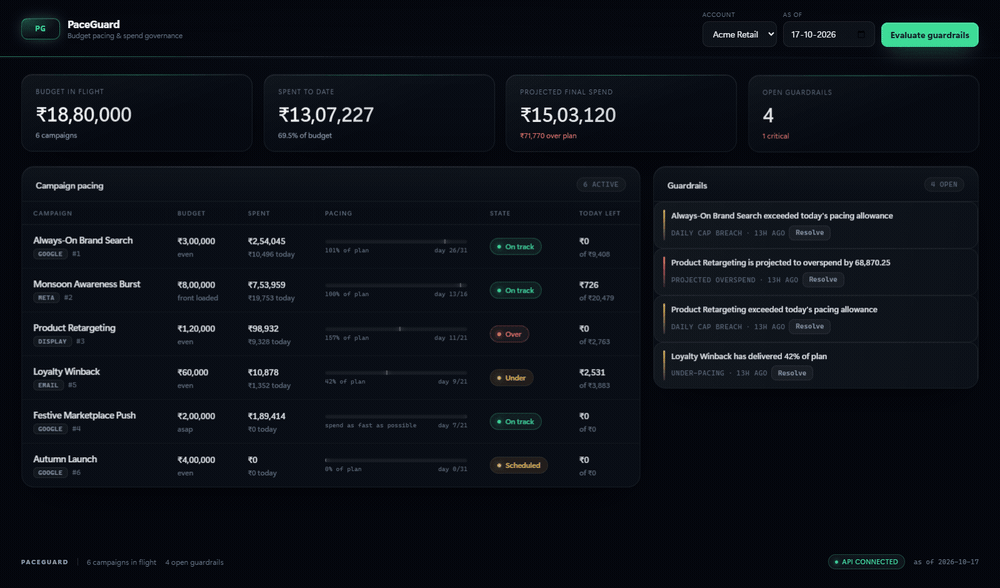

# PaceGuard

**Budget pacing and spend governance for multi-tenant ad operations.**

A campaign has ₹3,00,000 to spend over 31 days. On day 12 it has spent ₹2,10,000. Nothing is
"broken" — no API is down, no error is logged — but the flight will finish 70% over budget.
That is the failure mode this service exists to catch, and it is exactly the kind of failure
that is invisible to uptime monitoring.

PaceGuard ingests spend facts, computes each campaign's position against its **pacing curve**,
forecasts where the flight will land, and raises deduplicated guardrail alerts while there is
still time to act.

[](https://github.com/het12779-ui/paceguard/actions/workflows/ci.yml)


---

## Why this belongs in an Advertising Cloud

DeltaX runs an advertising cloud across Google, Meta, display and email, on hundreds of
multi-tenant SQL Server databases, with a Python/C#/Vue stack, BDD, CD and an ELK
monitoring stack. PaceGuard is a deliberate slice of that surface:

| DeltaX Associate Product Engineer requirement | Where it shows up here |
|---|---|
| Full-stack ownership (backend → UI) | FastAPI + SQLAlchemy backend, Vue 3 dashboard, one process, one command |
| Multi-tenant databases | Every business row carries `account_id`; API-key → tenant resolution; cross-tenant tests |
| SQL beyond CRUD | `GROUP BY` aggregation read-model, sargable date-range predicates, tenant-scoped unique constraints |
| REST APIs | Versioned `/api/v1` surface, Pydantic contracts, `409`/`422` semantics, idempotent ingest |
| Code that is "clear, concise, tested" | 46 tests, pure-money domain layer, BDD scenarios for business rules |
| BDD | `pytest-bdd` feature file written in ad-ops language, bound to the pure engine |
| CI/CD | GitHub Actions matrix + live container smoke test |
| ELK-style observability | One JSON object per log line with `request_id` / `tenant_id`, Prometheus `/metrics` |
| Advertising domain | Pacing curves, budget guards, spend ingestion, ad-ops alert taxonomy |
| MS SQL Server | ORM is dialect-neutral; `migrations/001_init.sql` is the SQL Server 2022 schema |

C# is not used here — this is a Python/Vue repository. The SQL Server DDL is included so the
schema decisions (cents as `BIGINT`, UTC `DATETIME2`, filtered index for open alerts) are
reviewable rather than implied.

---

## What it does

- **Pacing curves** — `even`, `front_loaded` (launch bursts) and `asap` (delivery-constrained).
- **Daily allowance** — what today's delivery may spend, recalculated from the *remaining*
  budget each day, so yesterday's underspend funds today rather than being lost.
- **Curve-aware forecasting** — projects final spend along the campaign's own curve instead of
  extrapolating a flat daily rate (which falsely flags every healthy front-loaded flight).
- **Guardrails** — projected overspend, under-pacing, budget exhaustion, daily cap breach and
  delivery stall, with a per-campaign/kind/day dedupe key and automatic resolution.
- **Idempotent spend ingest** — at-least-once platform sync cannot double-count spend; the
  unique constraint enforces it, not application-level checking.
- **Audit trail** — every budget change is recorded with actor, before and after.
- **Dashboard** — account switch, KPI strip, pacing bars against the curve, alert feed and a
  per-campaign drawer with a daily delivery chart.

---

## The dashboard

Two screens carry the product argument.



The motion is deliberate and thin: it happens once on load and then stops. A dashboard that keeps animating is a dashboard that is hiding its refresh.

**Campaign pacing** (top of this page) is the product, not a decorative chart.
Each row carries budget, spend, pace against the campaign's *own* curve, guardrail
state and today's remaining allowance — so the ASAP campaign spending fast is
visibly **not** flagged while the even-paced one beside it is.


**Campaign detail.** Click any row and the drawer answers *why*: daily delivery
against plan, projected final spend, projected overspend, and the budget-change
audit trail. An alert you cannot drill into is just an accusation.

Design notes, because these are decisions rather than decoration:

- motion is ambient and entrance-only — panels rise, bars grow once, a critical
  state pulses. Nothing moves *with* the data, so the screen stays readable
  while it polls.
- `prefers-reduced-motion: reduce` turns all of it off.
- plain ES modules and one stylesheet served by the app itself: no build step,
  no CDN, works offline.
- every panel is keyboard reachable — `Enter`/`Space` opens a campaign, `Esc`
  closes the drawer.

---

## Architecture

```
                        ┌──────────────────────────────┐
   platform sync ──────▶│  POST /api/v1/spend/batch    │  idempotent on
   (at-least-once)      │  unique(account_id, uid)     │  (account_id, event_uid)
                        └──────────────┬───────────────┘
                                       ▼
                        ┌──────────────────────────────┐
                        │  spend_events  (append-only) │
                        └──────────────┬───────────────┘
                                       │  2 GROUP BY queries per account
                                       ▼
   ┌────────────────────────────────────────────────────────────────────┐
   │ services/ledger.py      → SpendContext                              │
   │ services/pacing.py      → pure maths: curve, target, cap, forecast  │
   │ services/governance.py  → pure rules → AlertDraft[]                 │
   └───────────────────────────────┬────────────────────────────────────┘
                                   ▼
              GET  /api/v1/pacing/overview     GET  /api/v1/alerts
              POST /api/v1/pacing/evaluate     POST /alerts/{id}/resolve
                                   │
                                   ▼
                    Vue 3 dashboard (same origin, no CORS)
```

Design rule: **the money maths is pure**. `services/pacing.py` takes a dataclass and returns a
dataclass — no session, no clock, no HTTP. That is why the edge cases (day 0, zero budget,
budget exhausted, flight over) are cheap to test to the cent.

---

## Quickstart

### Windows (PowerShell)

```powershell
cd paceguard
python -m venv .venv
.venv\Scripts\python.exe -m pip install -r requirements-dev.txt
.venv\Scripts\python.exe -m uvicorn paceguard.main:app --app-dir src --port 8010
```

### macOS / Linux

```bash
cd paceguard
make install
make run          # http://127.0.0.1:8010
```

### Docker

```bash
docker build -t paceguard:1.0.0 .
docker run --rm -p 8080:8080 paceguard:1.0.0
```

Open <http://127.0.0.1:8010>. The database seeds itself on first boot with two tenants and
eight campaigns engineered to show every pacing state.

**Demo tenants** (demo mode is on by default outside Docker too):

| Account | API key | What it demonstrates |
|---|---|---|
| Acme Retail | `pg_demo_acme_key` | on-track, overspending, under-pacing and exhausted flights |
| Nova Travel | `pg_demo_nova_key` | a second tenant with fully isolated data |

> Demo mode lets the dashboard name a tenant with `X-Account-Id` instead of a key, so the
> browser holds no secret. It is off when `PACEGUARD_DEMO=0` — the tests assert that.

---

## API

| Method | Path | Purpose |
|---|---|---|
| `GET` | `/healthz` | Liveness (never touches the database) |
| `GET` | `/readyz` | Readiness (executes `SELECT 1`) |
| `GET` | `/metrics` | Prometheus text exposition |
| `GET` | `/api/v1/campaigns` | List campaigns for the tenant (`?status=`, `?channel=`) |
| `POST` | `/api/v1/campaigns` | Create a campaign (`409` on duplicate `external_id`) |
| `GET` | `/api/v1/campaigns/{id}` | Pacing snapshot + daily series + budget history |
| `PATCH` | `/api/v1/campaigns/{id}` | Update name/budget/mode/status, audited |
| `POST` | `/api/v1/spend` | Ingest one spend fact (idempotent) |
| `POST` | `/api/v1/spend/batch` | Ingest up to 500, per-row result counts |
| `GET` | `/api/v1/pacing/overview` | Account-wide pacing (`?as_of=YYYY-MM-DD`) |
| `POST` | `/api/v1/pacing/evaluate` | Run guardrails, create/resolve alerts |
| `GET` | `/api/v1/alerts` | Open alerts (`?open=false`, `?severity=`) |
| `POST` | `/api/v1/alerts/{id}/resolve` | Resolve an alert |

### Walkthrough

```bash
# 1. create a campaign
curl -s -X POST http://127.0.0.1:8010/api/v1/campaigns \
  -H "X-API-Key: pg_demo_acme_key" -H "Content-Type: application/json" \
  -d '{"external_id":"SRCH-99","name":"Search Always-On","channel":"google",
       "total_budget_cents":5000000,"pacing_mode":"even",
       "start_date":"2026-10-01","end_date":"2026-10-31"}'

# 2. post spend (safe to retry: the event_uid is the idempotency key)
curl -s -X POST http://127.0.0.1:8010/api/v1/spend \
  -H "X-API-Key: pg_demo_acme_key" -H "Content-Type: application/json" \
  -d '{"event_uid":"sync-2026-10-12-SRCH-99","campaign_external_id":"SRCH-99",
       "amount_cents":420000,"occurred_at":"2026-10-12T09:30:00+00:00"}'

# 3. where does this tenant stand?
curl -s "http://127.0.0.1:8010/api/v1/pacing/overview?as_of=2026-10-12" \
  -H "X-API-Key: pg_demo_acme_key"
```

Every money field is integer **minor units** (`*_cents`). Formatting is a UI concern; the API
never returns floats for money.

---

## The pacing model

For a flight of `N` days with `F(0)=0` and `F(1)=1`, the target to date is
`budget × F(elapsed/N)`.

| Mode | Curve | Rationale |
|---|---|---|
| `even` | `F(t) = t` | Always-on search and retargeting |
| `front_loaded` | `F(t) = (1 − e^{−kt}) / (1 − e^{−k})`, `k = 2.5` | Launch bursts: ~55% of budget in the first third |
| `asap` | `F(t>0) = 1` | Delivery-constrained: the budget is fair game immediately |

**Today's allowance** is not `budget / N`. It redistributes what is actually left:

```
remaining_before_today = budget − spend_before_today
today_allowance        = remaining_before_today × weight(today) / Σ weight(today…end)
```

**Forecast** follows the curve rather than a flat burn rate:

```
pace      = spent_to_date / target_to_date
projected = spent_to_date + (budget − target_to_date) × pace
```

If a flight is exhausted, the projection is simply what it has spent — a campaign that has run
out of budget does not keep spending.

That distinction matters. Extrapolating `spent / days_elapsed × total_days` labels a healthy
front-loaded campaign at its midpoint as a 155% overspend, because early days are *supposed* to
be the expensive ones. The curve-aware version projects it at 100%. There is a regression test
for exactly this (`test_projection_follows_the_curve_not_a_flat_daily_rate`).

### Guardrails

| Kind | Severity | Trigger |
|---|---|---|
| `PROJECTED_OVERSPEND` | warning ≥5%, critical ≥20% | Forecast exceeds budget |
| `UNDER_PACE` | warning | <80% of plan after 25% of the flight |
| `BUDGET_EXHAUSTED` | critical | Spend ≥ budget |
| `DAILY_CAP_BREACH` | warning | Today's spend > 110% of today's allowance |
| `DELIVERY_STALLED` | critical | Active campaign, day ≥2, zero spend today |

Alerts dedupe on `campaign:kind:date`, so evaluating 1,440 times a day still produces one alert.
When a condition clears, the next evaluation auto-resolves the open alert.

---

## Testing

```
tests/test_pacing_math.py       21  pure maths, exact cents, curve/threshold edges
tests/test_api.py               13  CRUD, idempotency, alerts, metrics, series
tests/test_tenant_isolation.py   9  cross-tenant reads/writes, schema guard, auth modes
tests/test_pacing_bdd.py         3  BDD scenarios (pytest-bdd)
                                ──
                                46  passing
```

```bash
python -m pytest -q          # 46 passed
python -m pytest -q -k bdd   # behaviour scenarios only
```

The BDD layer is intentionally *not* HTTP-shaped. Scenarios read like an ad-ops conversation:

```gherkin
Scenario: Hot campaign projects an overspend
  Given an even-paced campaign with a 10 day flight and a 100000 cent budget
  And 70000 cents spent by day 5
  When I evaluate pacing on day 5
  Then the pacing state is "overspending"
  And the projected overspend is 40000 cents
  And the guardrail raises a "PROJECTED_OVERSPEND" alert
```

Tenancy is treated as a security property, not a filter:

- every business table carries `account_id` (asserted by a schema-level test, so a future table
  cannot silently forget it);
- cross-tenant reads return `404`, never `403` — the API must not confirm that another tenant's
  campaign id exists;
- spend ingestion resolves the campaign *within* the tenant, so a foreign `external_id` is
  rejected as unknown;
- demo-mode bypass is covered by a test that proves it is refused when disabled.

---

## Measured results

`GET /api/v1/pacing/overview` end to end — FastAPI routing, two `GROUP BY` queries, pacing
maths, Pydantic serialisation and JSON encoding — on SQLite, Python 3.12, single uvicorn worker,
Windows 11 laptop. Reproduce with `python scripts/bench_overview.py`.

| Campaigns | p50 | p95 | max | Payload |
|---:|---:|---:|---:|---:|
| 10 | 7.4 ms | 8.5 ms | 9.6 ms | 5 KB |
| 100 | 13.4 ms | 19.6 ms | 23.6 ms | 48 KB |
| 1,000 | 72.1 ms | 101.8 ms | 132.6 ms | 483 KB |
| 5,000 | 423.4 ms | 700.2 ms | 707.9 ms | 2,425 KB |

The query count is constant (two aggregations, regardless of campaign count) — the growth is
serialisation, not N+1. The honest read: **the overview is unpaginated**. At 5,000 campaigns the
payload is 2.4 MB and p95 crosses half a second. The next change is cursor pagination plus a
`state=` filter, not a faster JSON encoder. At the 50–300 campaigns a real ad-ops pod owns, it is
single-digit to low-double-digit milliseconds.

---

## Observability

One JSON object per line, ready for Logstash → Elasticsearch → Kibana without a regex parser:

```json
{"ts":"2026-10-17T11:01:18+0530","level":"INFO","logger":"paceguard.access","message":"request",
 "request_id":"4cd30ae27e67","tenant_id":"1","method":"GET","path":"/api/v1/pacing/overview",
 "status":200,"duration_ms":8.42}
```

`X-Request-Id` is accepted from an upstream gateway or generated, then echoed on the response, so
a UI report and a log line can be joined. `/metrics` exports request counts, latency summaries and
ingest counters. Metric labels use the **route template** (`/campaigns/{campaign_id}`), not the
raw path — otherwise cardinality explodes on ids.

---

## Design decisions and trade-offs

| Decision | Why | Cost |
|---|---|---|
| Integer cents everywhere | Float money is a bug waiting for a reconciliation | Callers must know the unit; documented on every field |
| Curve-aware forecast | Flat-rate extrapolation creates alert noise on burst campaigns | Under-reacts to a short spike at the end of a flight |
| DB unique key for idempotency | At-least-once delivery is the norm; application checks race | Ingest must handle `IntegrityError` (done with SAVEPOINTs) |
| Tenant scoping in the repository | One forgotten `WHERE` is a data breach | Slightly more verbose queries |
| `404` for cross-tenant ids | Do not confirm existence across tenants | Slightly less debuggable for support |
| Demo mode via header | Keeps secrets out of the browser | Must be off in production; covered by tests |
| SQLite for the demo | Reviewer runs one command, zero infrastructure | Dialect differences documented in `migrations/` |
| Naive UTC in storage | `datetime2` has no offset; mixing aware/naive is a classic off-by-one | Conversion at the edges is explicit |

---

## Production path

This is a portfolio project, but the seams for production are deliberate:

1. **SQL Server** — point `DATABASE_URL` at `mssql+pyodbc://…` and apply `migrations/001_init.sql`.
   The read model uses only portable SQL.
2. **Auth** — replace the API-key dependency with the SSO/session exchange; `get_tenant` is the
   single choke point, so nothing downstream changes.
3. **Scheduling** — `/pacing/evaluate` is idempotent per campaign/kind/day and safe to run from a
   cron or queue worker every few minutes.
4. **Scale** — add pagination + `state` filter to the overview, then cache the account snapshot
   with a short TTL if 5k-campaign tenants appear.
5. **Alert delivery** — the `Alert` table is the outbox; a worker can push to Slack/email and
   stamp `resolved_at` from acknowledgements.

### Not implemented (and stated plainly)

- No scheduled evaluator inside the process — evaluation is an explicit `POST`.
- No rate limiting or API key rotation flow.
- The dashboard is a zero-build Vue app (vendored runtime, native ES modules) to keep the demo
  one command; in production it would be a Vite SPA with the same components.
- Single-currency formatting in the UI (the API stores a per-campaign currency).

---

## Layout

```
paceguard/
├── src/paceguard/
│   ├── api/            routers: campaigns, spend, pacing, alerts, system
│   ├── services/       pacing.py (pure maths), ledger.py (read model), governance.py (rules)
│   ├── models.py       accounts, campaigns, spend_events, alerts, audit_log
│   ├── tenant.py       API-key → account, demo-mode fallback
│   ├── metrics.py      dependency-free Prometheus exposition
│   ├── logging_setup.py JSON logs + request instrumentation
│   └── seed.py         deterministic demo dataset
├── tests/              46 tests incl. features/pacing.feature
├── web/                Vue 3 dashboard (vendored runtime, no build step)
├── migrations/         SQL Server 2022 DDL
├── scripts/            bench_overview.py
└── Dockerfile · Makefile · .github/workflows/ci.yml
```

Built by [Het Patel](https://github.com/het12779-ui) · MIT licensed.
